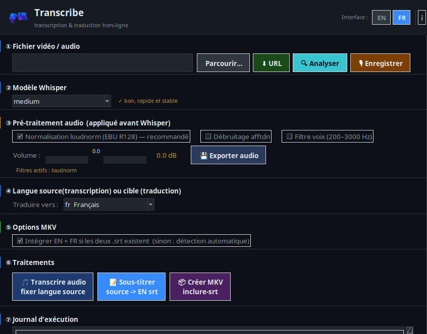
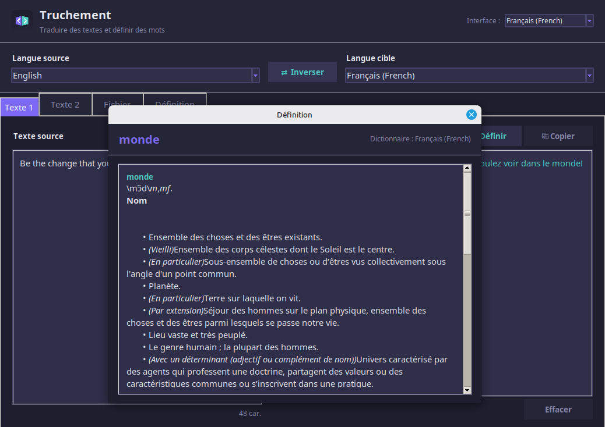

# Transcribe & Truchement

🇬🇧 [English version: README.md](README.md)

**Votre boîte à outils linguistique sur une clé USB — sans internet, sans compte, sans qu'aucune donnée ne quitte votre ordinateur.**

| | |
|---|---|
| 🎙️ **Transcribe** | **transcription et sous-titrage** — audio ou vidéo → texte, sous-titres `.srt`, `.mkv` sous-titré |
| 📖 **Truchement** | **traduction en local**, de textes, de documents et de **livres entiers**, avec ou sans LLM — et **dictionnaires monolingues** |
| 🔑 **Les deux** | fonctionnent **depuis une clé USB**, sur n'importe quelle machine, sans rien installer |

| Transcribe | Truchement |
|---|---|
|  |  |

---

## 🎙️ Transcribe — transcription et sous-titres

- **Sous-titrer une vidéo** : déposez une vidéo, obtenez un `.srt`, traduisez-le puis intégrez plusieurs pistes de sous-titres dans un seul `.mkv`.
- **Transcrire ou dicter** : audio, vidéo ou micro → `.txt`, dans de nombreuses langues, ou directement en anglais.
- **Audio difficile** : normalisation, réduction de bruit et réglage du volume avant transcription.
- Basé sur [whisper.cpp](https://github.com/ggml-org/whisper.cpp) ; les médias en ligne peuvent être récupérés au préalable avec yt-dlp.

## 📖 Truchement — traduction locale et dictionnaires

- **Sans LLM** ([Argos Translate](https://github.com/argosopentech/argos-translate), léger et rapide) : texte, `.txt`, `.srt`, `.docx`, `.pdf`, `.html` entre des dizaines de langues.
- **Avec un LLM local** (ex. TranslateGemma via [llama.cpp](https://github.com/ggml-org/llama.cpp)) : **livres entiers** — `.epub` → `.epub`, `.pdf` → Markdown, `.txt` → `.txt` — avec passe de révision bilingue, mise en forme conservée (italiques, notes, table des matières), *Essai* sur les premiers blocs, et *Pause / Reprise* même plusieurs jours après.
- **Dictionnaires monolingues** (français, anglais, espagnol, allemand, italien, portugais et d'autres), recherche plein texte : sélectionnez un mot dans une traduction pour afficher sa définition.

## 🔑 Depuis une clé USB

Tout — Python portable, modèles, paquets de traduction, dictionnaires — se trouve dans le dossier de l'application. Copiez ce dossier sur une clé : il fonctionne sur une autre machine, hors ligne, sans rien installer ni écrire dans le profil de l'utilisateur. Si un élément s'est perdu à la copie, le bouton **Diagnostic** de Truchement indique précisément lequel.

**Pourquoi hors ligne ?** Confidentialité (rien n'est envoyé), disponibilité (train, terrain, pare-feu), aucune dépendance (ni compte, ni clé d'API, licence MIT).

---

## Démarrage rapide

1. Téléchargez une version depuis la [page des Releases](https://codeberg.org/fhoudebert/transcribe/releases) et décompressez-la à son emplacement définitif (dossier ou clé USB).
2. Récupérez les composants lourds (Python portable, modèles Whisper, dictionnaires, paquets de langues) :
   - simplement, avec [**Baluchon**](https://github.com/fhoudebert/baluchon), qui sait aussi créer des raccourcis ;
   - ou avec `./setupPython_and_download.sh` (Linux, macOS) / `setupPython_and_download.bat` (Windows).
3. Lancez `transcribe` ou `truchement`.

Pour traduire des livres avec un LLM, démarrez d'abord un serveur llama.cpp et indiquez son adresse dans Truchement (bouton ⚙) — voir [developpement.md](developpement.md#translating-a-book-with-a-local-llm).

Installation détaillée, plateformes (Linux x86-64/arm64, Windows, macOS), compilation, arborescence, scripts en ligne de commande et dépannage : **[developpement.md](developpement.md)** · Particularités Windows : [README.windows.md](README.windows.md).

## Construit avec

[whisper.cpp](https://github.com/ggml-org/whisper.cpp) · [Argos Translate](https://github.com/argosopentech/argos-translate) · [llama.cpp](https://github.com/ggml-org/llama.cpp) · [FFmpeg](https://ffmpeg.org) · [yt-dlp](https://github.com/yt-dlp/yt-dlp) · [PyGlossary](https://github.com/ilius/pyglossary)

Suggestions et signalements de bugs : [gestionnaire de tickets](https://codeberg.org/fhoudebert/transcribe/issues). Licence : MIT — voir [LICENSE](LICENSE).

---

*Un « truchement », en vieux français, c'est un interprète — celui qui fait passer le sens d'une langue à l'autre. C'est exactement ce que fait cette boîte à outils, et elle tient dans la poche.*
