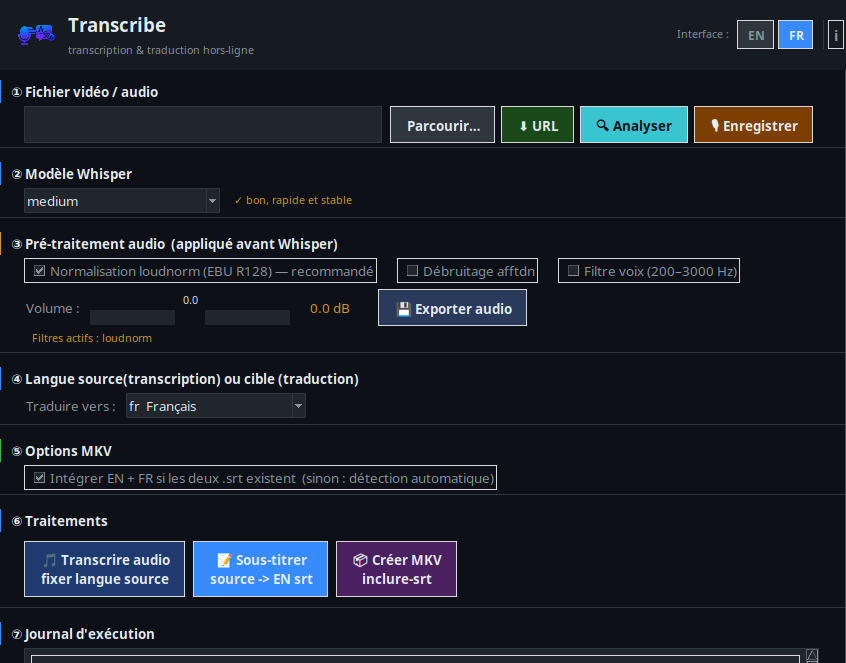
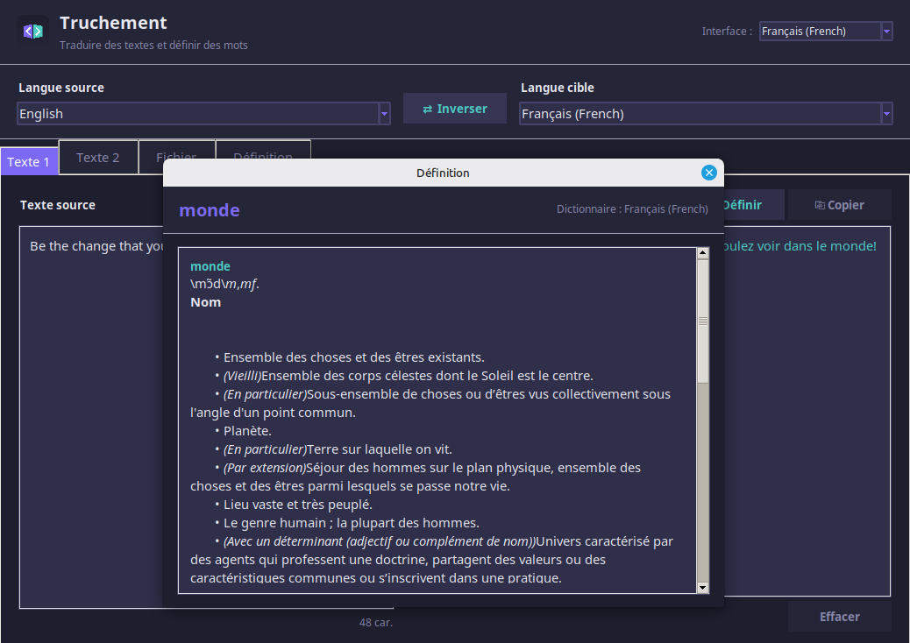

# Transcribe & Truchement

🇫🇷 [Version française : LisezMoi.md](LisezMoi.md)

**Your language toolbox on a USB stick — no internet, no account, no data leaving your computer.**

| | |
|---|---|
| 🎙️ **Transcribe** | **transcription and subtitling** — audio or video → text, `.srt` subtitles, subtitled `.mkv` |
| 📖 **Truchement** | **local translation**, of texts, documents and **whole books**, with or without an LLM — plus **monolingual dictionaries** |
| 🔑 **Both** | run **from a USB stick**, on any machine, with nothing to install |

| Transcribe | Truchement |
|---|---|
|  |  |

---

## 🎙️ Transcribe — transcription and subtitles

- **Subtitle a video**: drop in a video, get a `.srt` file, then translate it and embed several subtitle tracks into one `.mkv`.
- **Transcribe or dictate**: audio, video or microphone → `.txt`, in many languages, or directly into English.
- **Difficult audio**: normalisation, noise reduction and volume adjustment before transcription.
- Based on [whisper.cpp](https://github.com/ggml-org/whisper.cpp); online media can be fetched beforehand with yt-dlp.

## 📖 Truchement — local translation and dictionaries

- **Without an LLM** ([Argos Translate](https://github.com/argosopentech/argos-translate), light and fast): text, `.txt`, `.srt`, `.docx`, `.pdf`, `.html` between dozens of languages.
- **With a local LLM** (e.g. TranslateGemma via [llama.cpp](https://github.com/ggml-org/llama.cpp)): **whole books** — `.epub` → `.epub`, `.pdf` → Markdown, `.txt` → `.txt` — with a bilingual revision pass, kept formatting (italics, notes, table of contents), a *Trial* run on the first blocks, and *Pause / Resume* even days later.
- **Monolingual dictionaries** (English, French, Spanish, German, Italian, Portuguese and more), full-text search: select a word in a translation to jump to its definition.

## 🔑 From a USB stick

Everything — portable Python, models, translation packages, dictionaries — lives in the application folder. Copy that folder onto a stick and it works on another machine, offline, without installing anything or writing to the user profile. If something went missing during a copy, Truchement's **Diagnose** button says exactly what.

**Why offline?** Privacy (nothing is uploaded), availability (train, field, firewall), no lock-in (no account, no API key, MIT licence).

---

## Quick start

1. Download a release from the [Releases page](https://codeberg.org/fhoudebert/transcribe/releases) and unzip it into its final place (folder or USB stick).
2. Fetch the heavy components (portable Python, Whisper models, dictionaries, language packages):
   - the easy way, with [**Baluchon**](https://github.com/fhoudebert/baluchon), which can also create shortcuts;
   - or with `./setupPython_and_download.sh` (Linux, macOS) / `setupPython_and_download.bat` (Windows).
3. Launch `transcribe` or `truchement`.

To translate books with an LLM, start a llama.cpp server first and enter its address in Truchement (⚙ button) — see [developpement.md](developpement.md#translating-a-book-with-a-local-llm).

Installation details, platforms (Linux x86-64/arm64, Windows, macOS), building, folder layout, command-line scripts and troubleshooting: **[developpement.md](developpement.md)** · Windows specifics: [README.windows.md](README.windows.md).

## Built on

[whisper.cpp](https://github.com/ggml-org/whisper.cpp) · [Argos Translate](https://github.com/argosopentech/argos-translate) · [llama.cpp](https://github.com/ggml-org/llama.cpp) · [FFmpeg](https://ffmpeg.org) · [yt-dlp](https://github.com/yt-dlp/yt-dlp) · [PyGlossary](https://github.com/ilius/pyglossary)

Suggestions and bug reports: [issue tracker](https://codeberg.org/fhoudebert/transcribe/issues). Licence: MIT — see [LICENSE](LICENSE).

---

*« Truchement » is an old French word for an interpreter — someone who carries meaning between languages. That's exactly what this toolbox does, and it fits in your pocket.*
